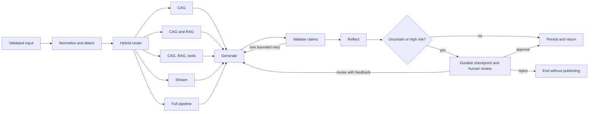

# Architecture

VERA is one stateful LangGraph workflow with specialized deterministic layers. It is not a
collection of autonomous agents. An optional bounded ReAct branch allows an external model
to choose evidence actions; the default deterministic route remains unchanged.



## Domain boundaries

- `domain`: validated request, evidence, claim, incident, and result contracts.
- `routing`: deterministic intent rules and optional LLM ambiguity resolution.
- `retrieval`: curated knowledge, hybrid retrieval, feed normalization, and sync storage.
- `sources`: read-only exact CVE clients with explicit unavailable results.
- `stream`: normalized event parsing, restricted PCAP extraction, rules, and statistics.
- `providers`: deterministic, OpenAI-compatible, Ollama, and Gemini generation.
- `reasoning`: citation validation, bounded repair, and structured reflection.
- `memory`: SQLite history, semantic memories, and pending-review decisions.
- `workflow`: LangGraph state transitions and dependency wiring.
- `interfaces`: Typer CLI and FastAPI HTTP API.

## Project layout

```text
src/vera/
├── domain/          Typed requests, evidence, reports, and graph contracts
├── workflow/        LangGraph topology, nodes, acquisition, and orchestration
├── retrieval/       Hybrid ranking, embeddings, corpus store, and feed sync
├── sources/         Read-only CVE.org, NVD, KEV, EPSS, and OSV adapters
├── stream/          Event parsing, PCAP extraction, detection, and statistics
├── providers/       Deterministic and external language-model providers
├── reasoning/       Claim validation and reflection
├── memory/          SQLite persistence and semantic or episodic recall
├── interfaces/      FastAPI and Typer entry points
└── data/
    ├── knowledge/   Stable CAG documents
    ├── corpus/      Bundled RAG documents
    ├── evaluation/  Controlled benchmark scenarios
    ├── samples/     Safe synthetic event streams
    └── web/graph/   Workflow explorer HTML, styles, and scripts

tests/
├── unit/            Isolated domain behavior
├── integration/     Workflow, API, UI, persistence, and evaluation
└── architecture/    Repository-wide structural constraints
```

## Routing contract

Events are normalized before routing. The meta-controller produces a typed `ResourcePlan`
containing independent CAG, RAG, tool, and stream flags plus extracted CVE and ATT&CK IDs.
`Route` remains a derived label for compatibility. Mixed requests can activate stream,
retrieval, and exact APIs together. Conceptual requests use CAG-only only when curated
knowledge actually covers the topic.

## Optional ReAct execution

When `VERA_REACT_ENABLED=true`, each acquisition branch first assembles local context;
the `tools` and `full` branches defer live lookups instead of running them automatically.
LangGraph then cycles through `react_decide` and `react_execute` until the model chooses
`finish` or a configured budget stops the loop. Typed decisions permit only local corpus
search and exact CVE lookups for identifiers already in the resource plan. Tool observations
join the evidence registry before the existing generation, validation, reflection, and
persistence nodes. Decision and execution counts are visible in the workflow explorer.
Each model decision requires a short operational reason, including `finish`. Reasons
appear in the persisted trace; executed action inputs, reasons, outcomes, and new
evidence IDs appear in `metadata.react_observations`. This is not private model reasoning.
No general web search is configured.

ReAct does not reveal private model reasoning or accept arbitrary URLs or commands.
Model calls include action decisions, routing, answer generation, and correction. Leave
`VERA_MAX_MODEL_CALLS` unset for an automatic budget: two calls in the default workflow,
or `VERA_MAX_REACT_STEPS + 3` with ReAct enabled. The additional three calls cover at most
one routing decision, one answer, and one correction. Three ReAct steps therefore permit
up to six model calls; all ten supported steps fit within the maximum of thirteen calls.
Each ReAct step counts one attempted model decision, including `finish` or an invalid
response. Finishing early does not consume the remaining allowance.

An explicit `VERA_MAX_MODEL_CALLS` remains a hard ceiling. With ReAct enabled it must cover
all configured steps and the three reserved calls; incompatible settings fail validation
rather than silently disabling the loop. Without ReAct, explicit limits remain between
one and four calls. Existing configurations that set `VERA_MAX_MODEL_CALLS=2` must remove
that override or raise it before enabling ReAct.

The ReAct loop cannot consume the two calls reserved for generation and correction.
Validation permits at most one model correction in ReAct mode, even if unused calls remain.
Persisted ReAct metadata records the resolved call limit, attempted decisions, and generation
attempts. CVE source requests share the global tool budget; exhausted or disabled lookups
remain explicit unavailable evidence.

## Safety boundaries

- Live tools only issue fixed read-only HTTP requests.
- PCAP extraction uses an argument list and never invokes a shell.
- Raw packet bytes are never sent to a model.
- Input count, PCAP size, model calls, tool calls, and HTTP timeouts are bounded.
- Evidence content is marked as untrusted data in model prompts.
- Unknown citation IDs cannot support a factual claim.
- Supported facts require a verbatim quotation from available non-memory evidence.
- Grounding checks meaningful term coverage, identifiers, numbers, and negation.
- Memory can support context but cannot establish an authoritative fact.
- Missing live information is represented as unavailable evidence.

## Workflow observability

`VeraOrchestrator.get_topology()` reads nodes, conditional edges, and Mermaid output from the
compiled LangGraph object. `/v1/graph` exposes that typed representation. `/graph` renders it
with local HTML, CSS, and JavaScript under a restrictive content security policy; no diagram
or execution data is sent to an external rendering service. A persisted run activates only
its selected acquisition branch and records repeated generation and validation nodes.
See [Workflow Explorer](workflow-explorer.md) for modes, interactions, and interpretation.

## Retrieval

Bundled JSON documents and optional synchronized JSONL feeds share the same evidence schema.
The ranker combines normalized BM25 (`0.7`) with normalized embedding similarity (`0.3`).
Exact identifiers such as CVE, CWE, CAPEC, and ATT&CK IDs remain searchable as single tokens.
Hash embeddings provide a deterministic baseline; Sentence Transformers remain optional.
Above the relevance threshold, a bounded candidate set is reranked by provenance
(synchronized feed versus dated snapshot), document date when available, and token
novelty. Nearly identical documents are suppressed. Each result retains its original
hybrid `retrieval_score` and exposes `quality_score`, `freshness_score`,
`novelty_score`, and `selection_score`. Undated stable guidance receives a neutral
freshness score; these heuristics do not independently verify source accuracy.

Corpus synchronization is explicit. The synchronizer downloads only allowlisted official
ATT&CK STIX and CISA KEV URLs, validates payload shape, normalizes source metadata, enforces
byte and document limits, and stages replacements before publishing local feed files.
Exact live sources execute concurrently. Provenance-aware deduplication preserves retrieval
order while preferring live API records over synchronized feeds and bundled snapshots.

## Claim grounding

Claims retain evidence IDs and add structured citations containing verbatim supporting
quotations. Validation checks registry integrity, quotation presence, meaningful term coverage,
identifiers, numeric values, and negation. Invalid claims receive one bounded retry when
available; otherwise they become explicit system inferences. Reflection and source coverage
are calculated from the grounded result rather than citation presence alone.

For OpenAI-compatible JSON Schema responses, the generation schema allows at most three
claims and enumerates the selected evidence IDs for claims and citations. Validation
still checks actual support; a structurally valid reference alone cannot establish a fact.

This deterministic layer rejects unrelated citations and simple contradictions. It remains a
conservative lexical check, not a complete natural-language inference model.

## Detection windows

Port scanning, authentication failures, and SYN bursts use configurable sliding windows.
Alerts expose observed count, threshold, first and last timestamps, duration, and confidence.
HTTP payload signatures remain event-local.

## Persistence

SQLite stores runs, evidence, reflection reports, and two memories per completed execution.
Semantic memory contains supported findings; episodic memory contains the request, route, and
outcome. Retrieval uses the configured local embedder and can be scoped by `session_id`.
LangGraph SQLite checkpoints and the review ledger hold unpublished drafts before finalization;
only approved drafts enter run history and memory. See [Human review](human-review.md).

## Domain knowledge graph

The optional [Kuzu integration](knowledge-graph.md) acquires evidence through bounded,
parameterized graph traversal in RAG/tools/full branches before generation. Entity and
assertion nodes preserve original source records. Structured mappings remain inferences;
factual claims still require quotations accepted by the existing validator. Runtime
metadata distinguishes attempted retrieval, retained evidence, and final citations.
SQLite commits run projection jobs atomically with history; idempotent Kuzu projection
retries failures. `/knowledge-graph` inspects domain data separately from `/graph`.
