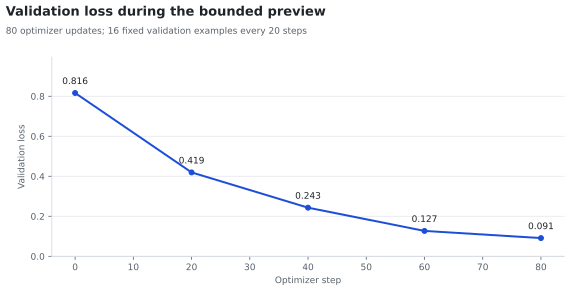
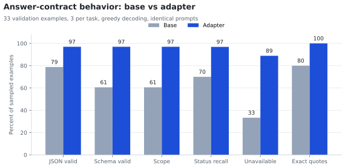
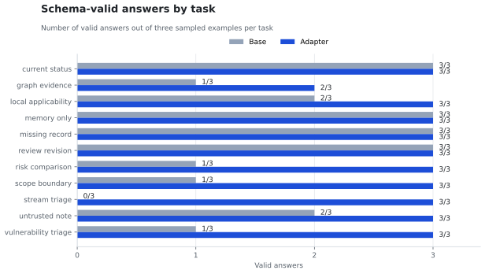

# Fine-tuning preview: answer-contract behavior

Date: 2026-10-28/29. Status: bounded preview, not a deployment decision.
This page records one experiment end to end: what was trained, how it was evaluated,
what improved and what still fails. The raw artifacts stay under `.vera/`, which is
ignored by Git; only this report, its charts and the tooling are versioned.

## Question

The knowledge needed for VERA's answers comes from retrieval, not from the model
weights. The experiment therefore asks a narrower question: after a short LoRA run,
does the model follow VERA's **answer contract** more reliably?

The contract covers JSON shape, the `out_of_scope` decision, the claim-status
vocabulary (`supported_fact`, `system_inference`, `unavailable`, `simulated`),
verbatim quotations and the rule that memory or absent records cannot establish facts.
It does not measure cybersecurity knowledge, and it is not a knowledge-distillation run.

## Setup

| Item | Value |
| --- | --- |
| Base model | `Qwen/Qwen3.5-4B`, revision `851bf6e8` |
| Adapter | LoRA rank 8, alpha 16, dropout 0, 7 projection modules |
| Precision / parallelism | FP32, eager attention, gradient checkpointing, model sharding over 2 T4 |
| Dataset | 3,939 train / 528 validation / 522 test, 11 tasks, 2,560-token budget |
| Targets | Synthetic, unchanged and not expert-reviewed |
| Optimizer | AdamW, lr 2e-5, weight decay 0.01, accumulation 8 |
| Budget | 80 updates = 640 examples, 16% of one epoch |
| Validation loss | 16 fixed examples every 20 updates |
| Hardware | 2 x Nvidia T4, 11 GiB cap per GPU |

The 80-update bound was fixed before the run; it was not selected on validation
results. The test split was neither trained on nor used for selection.

## Training

| Step | Validation loss |
| ---: | ---: |
| 0 | 0.8163 |
| 20 | 0.4193 |
| 40 | 0.2430 |
| 60 | 0.1268 |
| 80 | 0.0910 |



Training took 9,300 seconds (2 h 35 min) and peaked at 9.84 and 9.69 GiB of allocated
VRAM per GPU, so the FP32 two-T4 recipe stayed inside its memory cap.
The curve is monotone but it is measured on 16 fixed examples with synthetic targets:
it is evidence that optimization worked, not evidence of general quality.

## Behavioral evaluation

Both models answered the same 33 validation examples, three per task, with greedy
decoding and a 768-token limit. The base answers come from the same weights with the
adapter disabled, so prompts and sampling are identical. Scoring runs locally with the
production `GeneratedAnswer` model and `validate_and_repair` at the runtime coverage
threshold of 0.55. It never uses the targets as if they were evidence.



| Metric | Base | Adapter |
| --- | ---: | ---: |
| Valid JSON | 26/33 (78.8%) | 32/33 (97.0%) |
| Valid VERA schema | 20/33 (60.6%) | 32/33 (97.0%) |
| Correct `out_of_scope` | 60.6% | 97.0% |
| Mean status recall (schema-valid answers) | 0.700 | 0.969 |
| `unavailable` present when expected | 3/9 | 8/9 |
| `simulated` on replay examples | 0/3 valid | 3/3 |
| Citation failures (schema-valid answers) | 35.0% | 3.1% |
| Exact quotes among supported claims | 80% | 100% |
| Supported facts citing memory | 4 | 0 |
| Mean validation errors per answer | 0.50 | 0.03 |
| Mean output tokens | 497 | 231 |
| Mean generation seconds | 44.1 | 23.9 |

The largest gaps are behavioral rather than factual. The base frequently produced
invalid JSON, answered out-of-scope questions as security questions, treated memory as
authoritative evidence and ran to the token limit on event streams. The adapter stopped
earlier, used the status vocabulary and kept memory out of factual claims.

## By task



- **`scope_boundary`**: the base answered a lunar-eclipse question with a security
  explanation and `out_of_scope: false`; the adapter returned `out_of_scope: true`
  with no claims on 3/3 examples.
- **`memory_only`**: the base treated remembered content as a supported fact and
  produced four memory citations; the adapter returned `unavailable` with no
  evidence on 3/3 examples.
- **`stream_triage`**: all three base answers hit the 768-token limit and were
  truncated, which makes the JSON invalid; the adapter labelled the replay
  `simulated` and cited the stream evidence.
- **`current_status`**: the base cited snapshot or unavailable records as current
  facts; the adapter separated the snapshot from a live lookup on 2/3 examples.
- **`risk_comparison`, `vulnerability_triage`, `untrusted_note` and
  `local_applicability`** moved from one or two valid answers out of three to three.

## Residual failures

1. `graph_evidence`: one answer contains an unescaped quote inside a citation and is
   not valid JSON.
2. `current_status`: one citation quotes text that is not verbatim in the evidence.
3. `current_status`: one answer omits the expected `unavailable` claim.

These are contract-level defects, not missing domain facts. They are the first targets
for another bounded run.

## Limitations

- Thirty-three examples and one seed: the confidence interval on every rate is wide.
- Targets are synthetic and formulaic. The adapter also reproduces target phrasing
  closely, so matching summary text is not evidence of reasoning.
- One of the 33 evaluation examples overlaps the 16-example loss sample; the rest are
  disjoint from it.
- Citation rates are conditional on schema validity; invalid JSON is reported
  separately and never counted as a clean citation result.
- The test split remains untouched. A final claim about the recipe needs the test
  split, more examples and ideally a second seed.

## Reproduce

Build the aligned candidate and the code bundle, then run the notebook with
`MAX_STEPS = 80`, `VALIDATION_EVERY = 20`, `VALIDATION_EXAMPLES = 16`,
`RUN_BEHAVIORAL_EVAL = True` and `EVAL_PER_TASK = 3`:

```bash
uv run python finetuning/prepare.py --dataset <aligned.zip> --max-length 2560 \
  --output <staging>/vera-kaggle-training.zip
```

Score the downloaded answers locally and render the charts:

```bash
uv run python finetuning/score.py --dataset <aligned.zip> \
  --contract <runtime-contract.json> --answers answers.jsonl --output scores.json
uv run --extra analysis python finetuning/plot.py --report report.json \
  --scores scores.json --output docs/images/finetuning-preview-20261028
```

## Artifacts

Local, Git-ignored, under `.vera/finetuning/kaggle-preview-20261028-103035/`:

- `results/vera-full-20261028-103453/report.json` and `metrics.jsonl`
- `results/vera-full-20261028-103453/adapter/` and `checkpoint-000050/`,
  `checkpoint-000080/`
- `eval-results/vera-eval-20261029-095615/answers.jsonl` and `scores.json`

Private Kaggle resources:

- training kernel `danterolle/vera-preview-20261028-103035`
- evaluation kernel `danterolle/vera-preview-behavior-eval-20261028-103453`
- adapter dataset `danterolle/vera-preview-adapter-20261028-103453`

Code used for the run: `f583e47` (training and evaluation tooling), `16a2640`
(evaluation path fix), `cfb2323` (citation rate over schema-valid answers).
