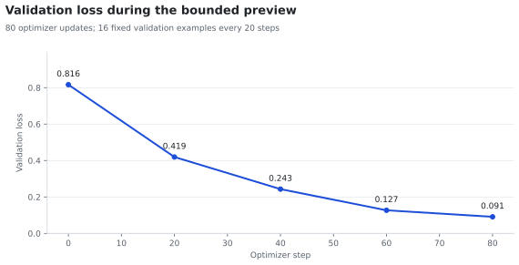
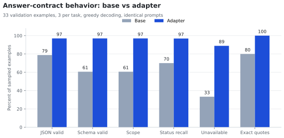
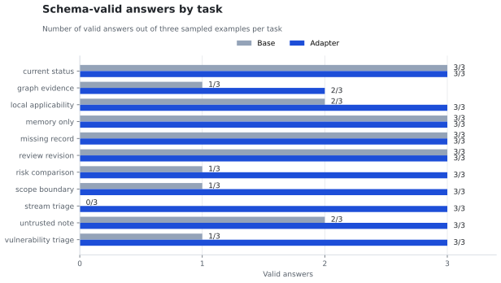

# Fine-tuning preview: answer-contract behavior

This report follows the bounded experiment run on 2026-10-28/29, from training
through evaluation. It records the improvements and failures observed at the time,
not a deployment decision or a qualification of today's runtime. Raw artifacts stay
under the ignored `.vera/` directory; the report, charts and tooling are versioned.

## Question

VERA is designed to retrieve the knowledge needed for an answer rather than rely
on its model weights for current facts. This experiment therefore asked a narrower
question: would a short LoRA run make the model follow the **answer contract**
more reliably?

The contract covers JSON shape, the `out_of_scope` decision, the claim-status
vocabulary (`supported_fact`, `system_inference`, `unavailable`, `simulated`),
verbatim quotations and the rule that memory or absent records cannot establish facts.
It does not measure cybersecurity knowledge, and it is not a knowledge-distillation run.

## Setup

| Item | Value |
| --- | --- |
| Base model | `Qwen/Qwen3.5-4B`, revision `851bf6e8` |
| Adapter | LoRA rank 8, alpha 16, dropout 0, 7 projection modules |
| Precision / parallelism | FP32, eager attention, gradient checkpointing, model sharding over 2 T4 |
| Dataset | 3,939 train / 528 validation / 522 test, 11 tasks, 2,560-token budget |
| Targets | Synthetic, unchanged and not expert-reviewed |
| Optimizer | AdamW, lr 2e-5, weight decay 0.01, accumulation 8 |
| Budget | 80 updates = 640 examples, 16% of one epoch |
| Validation loss | 16 fixed examples every 20 updates |
| Hardware | 2 x Nvidia T4, 11 GiB cap per GPU |

The training mix is skewed: `vulnerability_triage` supplies 1,332 examples and
`graph_evidence` 584, while eight tasks supply about 240 each and `stream_triage` 108.
The evaluation is stratified, three examples per task, so rare-task behavior carries
the same weight as the largest task.

The 80-update bound was fixed before the run; it was not selected on validation
results. The test split was neither trained on nor used for selection.

## Training

| Step | Validation loss |
| ---: | ---: |
| 0 | 0.8163 |
| 20 | 0.4193 |
| 40 | 0.2430 |
| 60 | 0.1268 |
| 80 | 0.0910 |



Training took 9,300 seconds (2 h 35 min) and peaked at 9.84 and 9.69 GiB of allocated
VRAM per GPU, so the FP32 two-T4 recipe stayed inside its memory cap.
The curve is monotone but it is measured on 16 fixed examples with synthetic targets:
it is evidence that optimization worked, not evidence of general quality.

## Behavioral evaluation

Both models answered the same 33 validation examples, three per task, with greedy
decoding and a 768-token limit. The base answers come from the same weights with the
adapter disabled, so prompts and sampling are identical. Scoring runs locally with the
production `GeneratedAnswer` model and `validate_and_repair` at the runtime coverage
threshold of 0.55. It never uses the targets as if they were evidence.



| Metric | Base | Adapter |
| --- | ---: | ---: |
| Valid JSON | 26/33 (78.8%) | 32/33 (97.0%) |
| Valid VERA schema | 20/33 (60.6%) | 32/33 (97.0%) |
| Correct `out_of_scope` | 60.6% | 97.0% |
| Mean status recall (schema-valid answers) | 0.700 | 0.969 |
| `unavailable` present when expected | 3/9 | 8/9 |
| `simulated` on replay examples | 0/3 valid | 3/3 |
| Citation failures (schema-valid answers) | 35.0% | 3.1% |
| Exact quotes among supported claims | 80% | 100% |
| Supported facts citing memory | 4 | 0 |
| Mean validation errors per answer | 0.50 | 0.03 |
| Mean output tokens | 497 | 231 |
| Mean generation seconds | 44.1 | 23.9 |

The main differences were behavioral. The base often produced invalid JSON, treated
unrelated questions as security requests, cited memory as authoritative evidence and
ran out of output tokens on event streams. The adapter stopped earlier, used the
expected statuses and kept memory out of factual claims.

## By task



On `scope_boundary`, the base answered a lunar-eclipse question as cybersecurity and
set `out_of_scope=false`. The adapter rejected all three unrelated requests without
claims. On `memory_only`, the base produced four citations to remembered content,
while the adapter returned `unavailable` without evidence in all three cases.

All three base `stream_triage` answers reached the 768-token limit and ended as
truncated JSON. The adapter instead labeled the replay `simulated` and cited its
stream evidence. On `current_status`, it distinguished a snapshot from live
verification in two of three cases. `risk_comparison`, `vulnerability_triage`,
`untrusted_note` and `local_applicability` each rose from one or two valid answers
to three.

## Residual failures

Three contract defects remained: an unescaped quotation made one `graph_evidence`
answer invalid JSON, one `current_status` citation was not verbatim, and another
omitted the expected `unavailable` claim. These failures concerned the response
contract rather than missing domain facts.

## Next stage

The original plan was to resume from a complete checkpoint and evaluate at 410, 660,
910 and 1,160 updates, corresponding to 0.83, 1.34, 1.85 and 2.35 epochs. The runner's
`--epochs` option reshuffles each epoch deterministically, while `--max-steps` remains
an absolute target. The plan kept the dataset, prompt, model revision, accumulation
and evaluation samples fixed, with an early stop if contract metrics plateaued or
regressed. Reaching a step count was not a goal in itself. The test split was to
remain untouched until configuration selection. The later
[step-400 report](finetuning-run-20261101.md) records what was actually run.

## Limitations

Thirty-three examples and one seed leave wide uncertainty around the reported rates.
The targets are synthetic and formulaic, and close reproduction of their wording
does not demonstrate reasoning. One evaluation example overlaps the 16-row loss sample;
the other 32 are disjoint.

Citation rates are conditional on schema validity. Invalid JSON was reported
separately rather than counted as citation-clean. At this stage the test split was
still untouched; a stronger conclusion needed held-out results, more examples and
ideally a second seed.

## Reproduce

Build the aligned candidate and the code bundle, then run the notebook with
`MAX_STEPS = 80`, `VALIDATION_EVERY = 20`, `VALIDATION_EXAMPLES = 16`,
`RUN_BEHAVIORAL_EVAL = True` and `EVAL_PER_TASK = 3`:

```bash
uv run python finetuning/prepare.py --dataset <aligned.zip> --max-length 2560 \
  --output <staging>/vera-kaggle-training.zip
```

Score the downloaded answers locally and render the charts:

```bash
uv run python finetuning/score.py --dataset <aligned.zip> \
  --contract <runtime-contract.json> --answers answers.jsonl --output scores.json
uv run --extra analysis python finetuning/plot.py --report report.json \
  --scores scores.json --output docs/images/finetuning-preview-20261028
```

## Artifacts

Local, Git-ignored, under `.vera/finetuning/kaggle-preview-20261028-103035/`:

- `results/vera-full-20261028-103453/report.json` and `metrics.jsonl`
- `results/vera-full-20261028-103453/adapter/` and `checkpoint-000050/`,
  `checkpoint-000080/`
- `eval-results/vera-eval-20261029-095615/answers.jsonl` and `scores.json`

Private Kaggle resources:

- training kernel `danterolle/vera-preview-20261028-103035`
- evaluation kernel `danterolle/vera-preview-behavior-eval-20261028-103453`
- adapter dataset `danterolle/vera-preview-adapter-20261028-103453`

Code used for the run: `f583e47` (training and evaluation tooling), `16a2640`
(evaluation path fix), `cfb2323` (citation rate over schema-valid answers).
