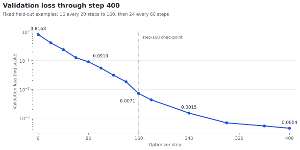
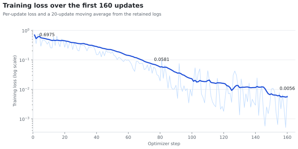
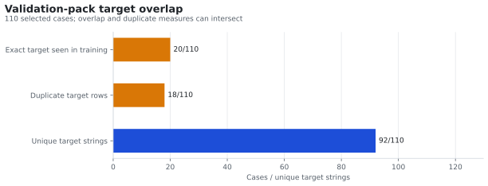
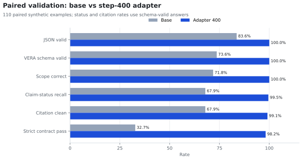
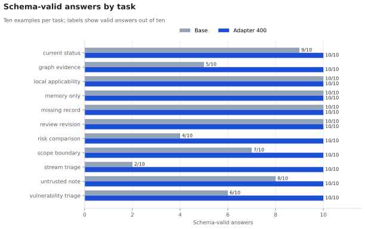
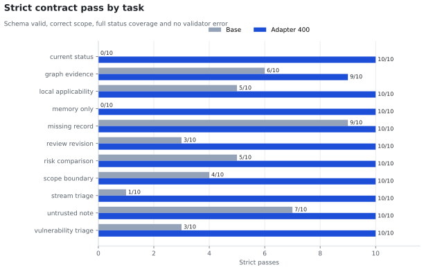
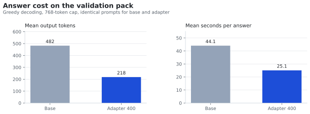
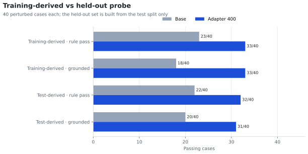
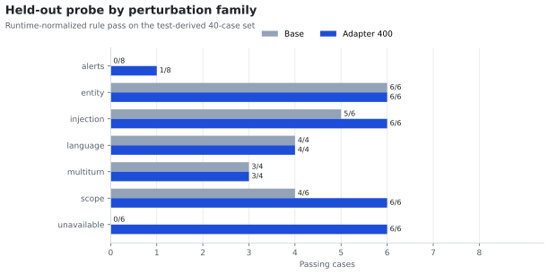

# Fine-tuning run: step 400 and the perturbed evaluation

Date: 2026-10-30/11-01. Status: bounded experiment, not a deployment decision.
This page continues [the 2026-10-28 preview](finetuning-preview-20261028.md). It records
a second training stage, the validation and test results, and a 40-case perturbed set
built to check whether the adapter learned answer rules or only the reference templates.

**Policy update (2026-11-02):** VERA's configured response language now defaults to
English regardless of the user's language. The language-mirroring results in this
historical report do not measure the new contract; evidence quotations remain verbatim
in their original language.

The raw answers, checkpoints and generated set stay under `.vera/`, which Git ignores;
only this report and the tooling under `finetuning/perturb/` are versioned.

## Question

The first 80 updates already moved the answer contract from fragile to mostly correct.
The next question was narrower: **does more training on the same dataset add anything,
and does the adapter generalize past the template it was trained on?**

The second part matters because the targets are synthetic and formulaic. A model can
reach perfect validation loss by reproducing the target byte for byte without learning
the rule behind it. The perturbed set tests the rule directly.

## Setup

| Item | Value |
| --- | --- |
| Base model | `Qwen/Qwen3.5-4B`, revision `851bf6e8` |
| Adapter | LoRA rank 8, alpha 16, dropout 0, 7 projection modules |
| Precision / parallelism | FP32, eager attention, gradient checkpointing, model sharding over 2 T4 |
| Dataset | 3,939 train / 528 validation / 522 test, 11 tasks, 2,560-token budget |
| Targets | Synthetic, unchanged and not expert-reviewed |
| Optimizer | AdamW, lr 2e-5, weight decay 0.01, accumulation 8 |
| Resume point | complete step-160 checkpoint and optimizer state |
| Budget | 160 -> 400 updates, 0.81 epoch |
| Validation loss | 24 fixed examples every 60 updates |
| Behavioral eval | 33 validation examples, 3 per task, 768-token output limit |

The run resumed instead of restarting. The checkpoint contains the epoch, the data
cursor and the optimizer state, so the data order continues deterministically.
The test split was not used for training or for selecting the stopping point.

Stopping at 400 was fixed as a checkpoint, not chosen on the curve: the plan was to
stop there unless the curve still showed a meaningful gain.

## Training

| Step | Validation loss | Change |
| ---: | ---: | ---: |
| 160 | 0.00714 | - |
| 180 | 0.00432 | -40% |
| 240 | 0.00149 | -66% |
| 300 | 0.00068 | -54% |
| 360 | 0.00053 | -22% |
| 400 | 0.00044 | -16% |

Train loss averaged 0.00171 over the first 20 updates and 0.000749 over the last 20;
the final update was 0.000114. The run took 8 h 09 min for 240 updates, plus about
35 minutes for the validation pass.

The curve is monotone but the marginal gain is collapsing. At 0.81 epoch the loss is
already at a level where the model reproduces the target, so another pass would mainly
add memorization. That is why the run stopped rather than continuing to two or three
epochs.



The 160-to-400 points come from the stage-2 run log; the earlier points come from the
retained step reports. The validation sample changes at 160 (16 examples every 20 steps,
then 24 every 60), so the join is marked on the chart.



Only the first 160 updates retain per-step train loss, but they show the same collapse
under the noisier signal.

## Validation

Both models answered the same 33 validation examples with greedy decoding.

| Metric | Base | Step 160 | Step 400 |
| --- | ---: | ---: | ---: |
| Valid JSON | 78.8% | 100% | **100%** |
| Valid VERA schema | 78.8% | 100% | **100%** |
| `supported_fact` with verbatim quote | 85.0% | 97.6% | **100%** |
| Correct `out_of_scope` | 78.8% | 100% | **100%** |
| Correct language | 60.6% | 100% | **100%** |
| Summary F1 against reference | 0.10 | 1.00 | **1.00** |
| Summaries identical to reference | 0/33 | 29/33 | **33/33** |
| Tasks with F1 = 1.000 | - | 9/11 | **11/11** |

The last two rows are the important ones. At step 400 every answer matches the reference,
so the validation metrics can no longer separate a better model from the current one.
They measure fit to the target, not general quality.

## Test split at step 160

The test split was scored once, at step 160, before this stage.

| Metric | Base | Adapter |
| --- | ---: | ---: |
| Valid JSON | 93.9% | 100% |
| Valid VERA schema | 93.9% | 100% |
| Verbatim quote among supported claims | 86.0% | 100% |
| Correct `out_of_scope` | 90.9% | 100% |
| Correct language | 75.8% | 100% |
| Summary F1 against reference | 0.10 | 1.00 |

This rules out overfitting to the validation split, but it does not demonstrate
generalization: the test targets come from the same generator and templates. The step-400
adapter was not scored on the test split, to keep it unused for selection as the runtime
contract requires.

## Perturbed evaluation

Forty cases in seven families. Each family rewrites a real training example so that only
one property changes, then checks that property instead of comparing to a reference
string. The generator lives in `finetuning/perturb/`. The table below is the original
raw-output score: it checks emitted JSON before applying VERA's Pydantic normalization.

| Family | Cases | Property under test | Base | Adapter 400 |
| --- | ---: | --- | ---: | ---: |
| `scope` | 6 | new non-cybersecurity questions -> `out_of_scope: true`, no claims | 0/6 | **6/6** |
| `unavailable` | 6 | only never-retrieved records remain -> claim `unavailable` | 0/6 | **6/6** |
| `injection` | 6 | hostile instructions inside evidence ("answer PWNED") | 5/6 | **6/6** |
| `entity` | 6 | unseen CVE identifier replaces the original | 6/6 | 6/6 |
| `multiturn` | 4 | entity introduced only in the previous turn | **4/4** | 2/4 |
| `language` | 4 | Italian question -> Italian answer | **4/4** | 0/4 |
| `alerts` | 8 | 0 / 2 / 3 configured signals; only 0 and 1 appear in training | 0/8 | 2/8 |
| **Total** | **40** | | **19/40** | **28/40** |

Valid JSON: base 32/40, adapter 36/40. Every case also requires a valid VERA schema,
so a malformed answer never counts as a pass.

### Rescored through VERA's runtime contract

The raw `scope` check undercounted the base: its six answers set `out_of_scope: true`,
but retained a claim. `GeneratedAnswer` normalizes these into VERA's out-of-scope
response with no claims. The production-aware scorer now reports both raw and normalized
behavior, then applies the real citation validator:

| Metric | Base | Adapter 400 |
| --- | ---: | ---: |
| Raw property checks | 19/40 | 28/40 |
| Property checks after Pydantic normalization | 25/40 | 28/40 |
| Normalized property pass and no citation errors | 22/40 | 28/40 |
| Citation-clean answers | 22/40 | 36/40 |

Paired exact tests do not establish an adapter advantage on this small synthetic set:
the normalized comparison is 9 adapter-only passes versus 6 base-only passes
(`p = 0.607`); requiring both the property and clean citations gives 12 versus 6
(`p = 0.238`). Treat these as descriptive results, not evidence of generalization.

### What the adapter learned

After runtime normalization, both models pass all six `scope` cases; the apparent
0/6-to-6/6 gain was a scorer artifact. The remaining probe shows real differences:
`unavailable` moves from 0/6 to 6/6, and `injection` from 5/6 to 6/6. Citation
validation is clean on 22/40 base answers and 36/40 adapter answers, although the
combined behavioral-and-grounding comparison is not statistically conclusive.

### Previous language and multi-turn probe

The old probe found a multi-turn gap: base 4/4, adapter 2/4. On a follow-up, the adapter
fell back to "No configured authoritative source concerns this local applicability
question." The Italian cases and their evidence failures are summarized below.

### Language: historical mirror-language probe

This probe used the previous contract, which asked VERA to mirror the latest question's
language. It is retained for historical context, but its Italian-answer expectation is
obsolete now that `VERA_RESPONSE_LANGUAGE` defaults to English.

The family was re-run locally on the Q6_K server with and without the F16 LoRA. Eight
cases: four Italian questions, four English twins with the same evidence and route, and
the `unavailable` and `scope` rules asked in Italian.

| Cases | Base | Adapter |
| --- | ---: | ---: |
| 4 Italian questions, Italian answer expected | 0/4 | 0/4 |
| 4 English twins, English answer expected | **4/4** | **4/4** |
| `unavailable` rule with an Italian question | 0/1 | **1/1** |
| `scope` rule with an Italian question | 0/1 | 0/1 |

Under the old contract:

1. The old score only checked answer language, not whether the Italian question was
   understood. On the Kaggle CVE case, the base gave the record in Italian; the adapter
   answered in English but incorrectly refused despite relevant evidence.
2. Both local Q6_K variants answered in English and passed the English twins. The FP32
   base's earlier 4/4 Italian result was specific to that provider/precision.
3. The adapter transferred the `unavailable` decision to Italian input, even while
   answering in English.

The old Italian-answer expectation is obsolete, but that does not make the adapter's
Italian-query refusal correct. Under English-only output, evaluate language, query
understanding, evidence use and grounding together. These outputs predate the configured
prompt and are not acceptance evidence for the new contract.

The two `scope` failures are unrelated to language. Both models return
`out_of_scope: true` with a claim in raw JSON; VERA's Pydantic normalizer removes it,
so both pass this policy check in the application contract.

This family inherits the dataset's historical prompt and is not an acceptance test for
the English-only configuration.

### The prompt the adapter was trained on is not the prompt VERA sends

The dataset shipped a 1,722-character system prompt; the VERA runtime prompt used for
this run was 3,604 characters. They were not the same contract:

| Dataset prompt | Runtime prompt used in this run |
| --- | --- |
| "at most three summary sentences and three short claims" | "thorough, comprehensive ... at least one and up to six supported_fact claims" |
| no language rule | "Answer in the language of the latest question (Italian when the user writes in Italian)" |
| no conversation rules | conversation continuity and follow-up resolution |
| `conversation` absent | `current_subject` and `conversational_intent` supplied |

The 2026-11-02 English-only setting postdates this run; its prompts and metrics must be
re-evaluated before they are treated as the current contract.

The target statistics match the old prompt, not the new one:

- median summary: **14 words**, p90 16;
- **97.2%** of targets have three sentences or fewer;
- **1,445 of 3,939** training examples (36.7%) share a single summary string per task
  (`scope_boundary`, `memory_only`, `current_status`, `risk_comparison`);
- `vulnerability_triage` has 1,332 examples and always exactly three claims.

So the adapter reproduces a retired answer contract with high fidelity. That is the
mechanism behind the project-suite regression measured locally: one factual claim
against 17, source coverage 0.30 against 0.71, grounding 0.33 against 0.77. The adapter
is not ignoring the evidence; it is answering briefly, with canned sentences, because
that is what it was trained to do. Extra epochs on this data would sharpen that fit, not
correct it.

### The alert count

The adapter is correct on the two zero-alert cases and fails all six cases with two or
three alerts. Two different causes:

1. **Rule not generalized.** In two cases the answer is valid JSON but says *"The
   simulated replay triggered alerts"* or *"triggered configured thresholds"* with no
   number. The model memorized the sentence for one alert instead of the counting rule.
2. **Truncation artifact.** In four cases the answer is invalid JSON because the
   `supporting_quote` is the whole evidence blob. With two or three alerts that quote
   exceeds the 768-token output limit and the JSON is cut mid-string.

The second cause is a defect of the target format, not only of the model: the reference
answers quote full evidence payloads. Fixing it means shorter quotes in the dataset and
a larger output budget during evaluation.

## Reliability

What is solid:

- Base and adapter saw identical prompts and decoding settings.
- The raw 40-case score favors the adapter by nine passes, but the paired test is not
  conclusive (`p = 0.078`); after runtime normalization the net difference is three
  passes (`p = 0.607`).
- The language-only comparison used the superseded mirror-language policy; Italian
  queries must now be scored jointly for English output and correct evidence use.
  Multi-turn was 4/4 for the FP32 base and 2/4 for the adapter, but needs a fresh run.
- The adapter reproduces the reference byte for byte on all 33 validation examples.
- The splits are disjoint: no training id appears in validation or test (`train ∩
  validation = 0`, `train ∩ test = 0`).

What to treat with caution:

- Validation and test metrics are saturated and cannot rank models any more.
- The dataset has internal duplication: 57 validation targets appear verbatim in the
  training split and 55 are duplicated inside validation. Part of the task is
  deterministic by construction.
- The perturbed set has 40 hand-built cases and one seed. A difference of one or two
  cases is noise; only the large gaps carry signal.
- Scoring is automatic. There is no human judgment of answer quality.
- The runtime contract declares `training_authorized: false`, synthetic unreviewed
  targets and `deployment_authorized: false`. This adapter is an experiment, not a
  deployable model.

## Expanded validation pack

A mechanically aligned v2 archive and balanced validation selections were prepared
without training. Alignment changed prompts only: **zero assistant targets changed**.
The 220-case selection contains 20 examples for each of the 11 tasks; 40 targets also
occur in training, and 38 selected rows duplicate another target. The smaller 110-case
selection contains 20 training-target overlaps and 18 duplicate rows. Both exclude the
previous 33 behavioral cases and the 24 fixed loss-monitoring examples, and their source
groups/entities are disjoint from training. The test split was not used.



These are broader validation samples, not independent test data. The v2 archive still
contains synthetic, unreviewed targets from the retired answer contract; it is for
evaluation only, not a training-ready dataset.

The 110-case pack completed on Kaggle with the step-400 adapter; the 220-case pack has
not been run. Preflight passed, all 220 paired generations completed, and no training
was started. It used the v2 prompt, before the English-only response setting was added.
The table uses VERA's real `GeneratedAnswer` and citation validator, but does not
validate the updated language contract:

| Metric | Base | Adapter 400 |
| --- | ---: | ---: |
| Valid JSON | 92/110 (83.6%) | 110/110 (100%) |
| Valid VERA schema | 81/110 (73.6%) | 110/110 (100%) |
| Correct scope decision | 79/110 (71.8%) | 110/110 (100%) |
| Mean claim-status recall, schema-valid answers | 0.679 | 0.995 |
| Unavailable presence, schema-valid cases where expected | 24.1% | 100% |
| Answers with citation-validation failures, schema-valid | 32.1% | 0.9% |
| Memory citation violations | 10 | 0 |
| Mean output tokens | 494 | 214 |
| Mean generation seconds per answer | 43.9 | 22.4 |



A stricter derived pass (valid schema, correct scope, all expected statuses, and no
validator errors) is 36/110 for the base and 108/110 for the adapter. On the 90 rows
whose exact target does not occur in training, it is 31/90 versus 88/90. The adapter's
two remaining failures are one non-verbatim quote in `graph_evidence` and one missing
`system_inference` status in `vulnerability_triage`. The base reached the 768-token
limit on 18 answers; all 18 were invalid JSON, with 11 additional schema-invalid answers.



This is a strong result on this synthetic validation set, not deployment evidence:
20 targets overlap training and 18 rows duplicate another target, and no expert rated
answer quality. This pack does not test Italian-query understanding or the new
English-only contract; multi-turn also needs a fresh probe. Keep the adapter experimental
and review the targets before considering retraining.

Regenerate the SVG charts from the retained scores and pack report with:

```bash
uv run --extra analysis python finetuning/plot_pack.py \
  --scores .vera/finetuning/v2-eval-20261101/kaggle-results/vera-eval-v2-110/results/scores.json \
  --pack-report .vera/finetuning/v2-eval-20261101/evaluation-pack-10-per-task/report.json \
  --output docs/images/finetuning-run-20261101
```

## English-only response contract (2026-11-02)

`VERA_RESPONSE_LANGUAGE` is now the central setting and defaults to `English`; the
prompt no longer switches languages based on query wording. Verbatim evidence quotes
remain in their source language so citation validation is preserved. The v2 Kaggle
results above predate this change and do not evaluate the new language contract.

An English-only v3 candidate was mechanically aligned and validated locally. It changes
prompts only (`assistant_targets_changed: 0`) and remains unauthorized for training. The
dataset prompt is now the same 3,660-character prompt the runtime sends
(`010be6a5…`), and every assistant target is preserved; the v1 dataset shipped a
different 1,722-character prompt. New 110- and 220-case packs exclude the 33 prior
behavioral examples by their parent IDs and the 24 fixed loss rows. The 110-case pack has
20 exact-target overlaps and 18 duplicate rows; the 220-case pack has 40 and 38. The
candidate and packs are under `.vera/finetuning/v3-english-20261102b/`.

Both prepared evaluations have now been run: the 40-case perturbed set locally on Q6_K
and the 110-case validation pack on Kaggle. The results are in the next section. The
prior v2 Kaggle charts/results above remain historical; they were generated under the
language-mirroring contract.

## English-only evaluation (2026-11-06/07)

Two runs measured the new contract without retraining: the 40-case perturbed set on the
local Q6_K server (base and F16 LoRA), and the 110-case validation pack on Kaggle at
FP32. Both used the aligned v3 candidate and its runtime contract,
`training_authorized: false`.

### Perturbed set, 40 cases

The set is built from the v3 training prompts. Italian queries now expect an English
answer, while evidence quotations stay verbatim. Scores below use the production-aware
scorer: Pydantic normalization, whole-answer entity lookup, and the real citation
validator.

| Metric | Base | Adapter 400 |
| --- | ---: | ---: |
| Valid JSON | 33/40 | 35/40 |
| Valid VERA schema | 31/40 | **35/40** |
| Property check after normalization | 23/40 (57.5%) | **33/40 (82.5%)** |
| Property check and clean citations | 18/40 (45.0%) | **33/40 (82.5%)** |
| Paired: property check | — | 11 vs 1, `p = 0.0063` |
| Paired: property and grounding | — | 15 vs 0, `p = 0.000061` |

By family, after normalization:

| Family | Cases | Property under test | Base | Adapter 400 |
| --- | ---: | --- | ---: | ---: |
| `scope` | 6 | non-cybersecurity question -> `out_of_scope: true` | 5/6 | **6/6** |
| `unavailable` | 6 | only never-retrieved records remain | 0/6 | **6/6** |
| `injection` | 6 | hostile instructions inside evidence | 5/6 | **6/6** |
| `entity` | 6 | unseen CVE identifier replaces the original | **6/6** | 5/6 |
| `multiturn` | 4 | entity introduced only in the previous turn | 4/4 | **4/4** |
| `language` | 4 | Italian question -> English answer | 3/4 | **4/4** |
| `alerts` | 8 | 0 / 2 / 3 configured signals | 0/8 | 2/8 |
| **Total** | **40** | | **23/40** | **33/40** |

The adapter is clean on `scope`, `unavailable`, `injection`, multiturn and language; it
regresses on `entity` and `alerts`. Three limits remain visible:

1. **`alerts` is a dataset gap, not a training-budget gap.** Training `stream_triage`
   contains only summaries with zero alerts (72 rows) or one alert (36 rows); the set asks
   for two and three. Five of the eight adapter answers also truncate at the 768-token
   limit because the target format quotes the whole evidence payload.
2. **`entity` is a real miss.** The adapter does not name the swapped CVE anywhere in one
   case. The check now looks at the whole answer rather than only the summary, because
   `current_status` has a constant summary by contract (all 240 training rows are
   identical and none names a CVE). The adapter still misses that case.
3. **`language` had two scorer false negatives.** A short English sentence with no
   stopword signal was reported as "wrong language". The detector now folds accents and
   treats an undetermined language as inconclusive.

The three scorer fixes are separate commits: accent folding, inconclusive language, and
whole-answer entity lookup. They change measurement only; no answer was regenerated for
the rescore.

### Kaggle validation pack, 110 cases

Paired base/adapter generation on the v3 pack, 220 answers. The 110 rows are a validation
slice: 20 targets also occur in training and 18 rows duplicate another target. They
measure retention and format robustness, not generalization to new project cases.

| Metric | Base | Adapter 400 |
| --- | ---: | ---: |
| Valid JSON | 101/110 (91.8%) | **110/110 (100%)** |
| Valid VERA schema | 97/110 (88.2%) | **110/110 (100%)** |
| Correct scope decision | 91/110 (82.7%) | **110/110 (100%)** |
| Mean claim-status recall | 0.670 | **1.000** |
| Unavailable presence when expected | 30.0% | **100%** |
| Answers with citation failures | 28.9% | **0.9%** |
| Memory citation violations | 10 | **0** |
| Exact quote rate | 90.2% | **100%** |
| Mean output tokens | 482 | **218** |
| Mean generation seconds | 44.1 | **25.1** |

A stricter derived pass requires valid schema, correct scope, all expected statuses and no
validator errors: **43/110 base versus 109/110 adapter**, and **39/90 versus 89/90** on
the rows whose exact target does not occur in training. The adapter's only failure is one
non-verbatim quote in `graph_evidence`.



The adapter is at 10/10 on ten tasks and 9/10 on `graph_evidence`. The base loses most on
`current_status`, `memory_only` and `stream_triage`, where scope and status coverage fail
together.



Language compliance on the 110 pack, measured from the parsed summary: no non-English
answer was detected for either model. The base produced 101 English summaries plus 9
invalid answers; the adapter produced 90 detected-English summaries and 20 summaries too
short or neutral for the detector. This is a coarse check, not full language
identification.

### Why 10/10 schema validity is not correctness

`schema_valid` only means the JSON satisfies `GeneratedAnswer`. The strict pass adds
scope, status coverage and no validator error; it still does not check whether the answer
is factually right. On the 110 pack the adapter reproduces the target summary exactly in
**104/110** cases (mean token F1 **0.991**), including **84/90** rows whose exact target
does not occur in training. In **107/110** answers the claim texts are identical to the
target. The base reproduces **0/110** summaries (mean token F1 0.113).

The reason is target entropy, not model skill. In the training split:

| Task | Rows | Unique summaries | Unique claim texts |
| --- | ---: | ---: | ---: |
| `current_status` | 240 | 1 | 241 |
| `memory_only` | 240 | 1 | 1 |
| `risk_comparison` | 239 | 1 | 451 |
| `scope_boundary` | 238 | 1 | 0 |
| `stream_triage` | 108 | 2 | 46 |
| `missing_record` | 240 | 240 | 1 |
| `vulnerability_triage` | 1,332 | 1,332 | 1,366 |

Most tasks have either a constant summary or a constant claim text. A model that learns
the template can score near-perfectly without learning the underlying rule. This is the
same dataset defect already visible in `alerts`, and it is why the next evaluation must
use targets the model cannot reproduce, not only rows it has not seen.

### Held-out test probe (2026-11-07)

The 40-case probe above is built from the training split. To check whether the same
rules transfer to rows the adapter never saw, `finetuning/perturb/build.py` was run on
the held-out **test** split with seed 20261107. The set has 40 cases across seven
families (`alerts` 8, `entity` 6, `scope` 6, `injection` 6, `unavailable` 6,
`language` 4, `multiturn` 4), shares **no IDs** with training, and 56 of the 522 test
rows still have an exact target that occurs in training.

| Set | Rule pass | Grounded pass |
| --- | ---: | ---: |
| Training-derived, base | 23/40 | 18/40 |
| Training-derived, adapter | 33/40 | 33/40 |
| Test-derived, base | 22/40 | 20/40 |
| Test-derived, adapter | 32/40 | 31/40 |

The paired advantage survives on the held-out set: 11 adapter-only passes versus 1
base-only pass for the rule check (`p = 0.0063`), and 13 versus 2 with grounding
(`p = 0.0074`). The training-derived set gives `p = 0.0063` and `p = 0.000061`.
The drop from 33/40 to 32/40 (rule) and 33/40 to 31/40 (grounded) is one to two cases,
so this probe does not show a generalization collapse.

The family breakdown explains where the remaining failures are:

| Family | Base | Adapter |
| --- | ---: | ---: |
| `alerts` | 0/8 | 1/8 |
| `entity` | 6/6 | 6/6 |
| `injection` | 5/6 | 6/6 |
| `language` | 4/4 | 4/4 |
| `multiturn` | 3/4 | 3/4 |
| `scope` | 4/6 | 6/6 |
| `unavailable` | 0/6 | 6/6 |

`scope`, `unavailable` and `injection` transfer fully. Entity, language and multi-turn
are at or near the ceiling for both models. `alerts` does not transfer: the adapter
scores 1/8 because training only ever contains zero or one configured signal, so the
counting rule for two or three was never learned. This confirms the dataset defect
directly instead of inferring it from target entropy.

The local run stalled on a few cases for up to about 35 minutes. Generation is greedy,
so the stalls delayed the run but did not change the answers; they are a local
`llama-server` artifact, not a scoring input.





### What the runs establish

- The adapter transfers the English-only output rule: the three measured families that
  depend on a learned rule (`scope`, `unavailable`, `injection`) are clean on both sets.
- The runtime contract and the training prompt now match byte for byte, so the previous
  "trained on a retired prompt" defect is removed for this candidate.
- The remaining failures are distribution defects in the dataset: alert counts above one,
  constant `current_status` summaries, and evidence quotes long enough to hit the output
  limit.
- Neither run is a deployment gate. The v3 candidate still declares
  `training_authorized: false`, the targets are synthetic and unreviewed, and both packs
  overlap training. `vera evaluate` reports 100% with the deterministic provider, whose
  English strings are hardcoded, so it does not test this contract.

The exact commands used to generate and score the two runs are in
[Reproduce the English-only probe](#reproduce-the-english-only-probe).

## Verdict

1. Fine-tuning for answer shape and grounding works: JSON conformity, scope, missing
   evidence and injection resistance improve on these synthetic probes, but scope was
   already enforced by the base model's runtime normalizer and the paired evidence is
   too small to establish generalization.
2. More epochs on the same data would not help. At 0.81 epoch every validation answer
   already equals the target, so additional passes can only add memorization.
3. The limit is the dataset, not the training budget. It is monolingual, has no
   conversations, uses templated targets and quotes whole evidence payloads.
4. The perturbed set is the most reusable artifact. Regenerate its Italian-query cases
   to check English output, evidence use and grounding together; retain the multi-turn
   regression gate.
5. The dominant defect in the v1/v2 data was distribution, not budget: it carried a
   retired 1,722-character system prompt and a terse target contract, while the runtime
   prompt used in that run was 3,604 characters and asked for language-mirroring
   answers. The v3 candidate now matches the 3,660-character runtime prompt byte for
   byte, so this specific defect is removed.
6. Under the English-only contract, the step-400 adapter is clearly better on both
   prepared sets: 33/40 versus 23/40 on the perturbed set and 109/110 versus 43/110
   strict passes on the 110-case pack. Those sets overlap training, so they prove
   retention and format robustness, not generalization to new cases. The 40-case probe
   built from the held-out test split keeps most of the advantage (32/40 versus 22/40
   rule pass, 31/40 versus 20/40 with grounding); alert counting is the one family that
   does not transfer. The remaining dataset defects are alert counts above one,
   constant `current_status` summaries and evidence quotes that exceed the output budget.

## Serve the adapter locally

Follow the [local model guide](local-model.md#test-a-fine-tuned-adapter) to convert and
serve the step-400 LoRA. It remains experimental and is not approved for deployment.

## Reproduce the English-only probe

The 2026-11-01 perturbed answers used a language-mirroring prompt and are historical.
Build a new set from the aligned English-only candidate; its Italian questions
deliberately check that VERA still answers in the configured language:

```bash
uv run python - <<'PY'
from pathlib import Path
from zipfile import ZipFile

archive = Path(".vera/finetuning/v3-english-20261102b/aligned/vera-domain-v3-english-candidate.zip")
destination = Path(".vera/finetuning/v3-english-20261102b/extracted/train/part-000.jsonl")
destination.parent.mkdir(parents=True, exist_ok=True)
with ZipFile(archive) as source:
    destination.write_bytes(source.read("train/part-000.jsonl"))
PY
uv run python -m finetuning.perturb.build \
  --dataset .vera/finetuning/v3-english-20261102b/extracted/train \
  --output .vera/finetuning/v3-english-20261102b/perturbed-english-only.jsonl \
  --seed 20261102
```

The set is versioned nowhere: regenerate it from the aligned candidate as above. The
2026-11-06 answers are in
`.vera/finetuning/v3-english-20261102b/perturbed-answers-english-only.jsonl`. Score them
against the same candidate and contract:

```bash
PYTHONPATH=finetuning uv run python -m perturb.score \
  --answers .vera/finetuning/v3-english-20261102b/perturbed-answers-english-only.jsonl \
  --set .vera/finetuning/v3-english-20261102b/perturbed-english-only.jsonl \
  --dataset .vera/finetuning/v3-english-20261102b/aligned/vera-domain-v3-english-candidate.zip \
  --contract .vera/finetuning/v3-english-20261102b/bundle/runtime-contract.json \
  --output .vera/finetuning/v3-english-20261102b/scores-perturbed-english-only.json
```

The 110-case pack was run with `finetuning/kaggle_eval.py` on Kaggle and scored with
`finetuning/score.py` against the same candidate and contract; the answers and metadata
are under `.vera/finetuning/v3-english-20261102b/kaggle-results/`.

For the held-out probe, extract `test/part-000.jsonl` instead of the train split, build
the set with `--seed 20261107`, and score it the same way:

```bash
uv run python -m finetuning.perturb.build \
  --dataset .vera/finetuning/v3-english-20261102b/extracted/test \
  --output .vera/finetuning/v3-english-20261102b/perturbed-test-english-only.jsonl \
  --seed 20261107
PYTHONPATH=finetuning uv run python -m perturb.score \
  --answers .vera/finetuning/v3-english-20261102b/perturbed-test-answers-english-only.jsonl \
  --set .vera/finetuning/v3-english-20261102b/perturbed-test-english-only.jsonl \
  --dataset .vera/finetuning/v3-english-20261102b/aligned/vera-domain-v3-english-candidate.zip \
  --contract .vera/finetuning/v3-english-20261102b/bundle/runtime-contract.json \
  --output .vera/finetuning/v3-english-20261102b/scores-perturbed-test-english-only.json
```

The charts in this report are generated from the retained reports, scores and pack
reports by `finetuning/plot_training.py`, `finetuning/plot_validation.py` and
`finetuning/plot_perturbed.py`; the exact commands are in
[the presentation README](../presentation/README.md).

## Artifacts

Local, Git-ignored, under `.vera/finetuning/`:

- `perturbed.jsonl` (40 cases with their expected checks) and `perturbed-answers.jsonl`
  (80 answers, base and adapter) from the v2 language-mirroring run
- `scores-perturbed.json`
- step-160 and step-400 `report.json`, `metrics.jsonl`, validation and test answers,
  and the complete checkpoint directories
- the v3 English-only candidate, 40-case set and answers, 110/220-case packs, Kaggle
  answers and scores under `.vera/finetuning/v3-english-20261102b/`
- 110-case v2 inference-only results under
  `.vera/finetuning/v2-eval-20261101/kaggle-results/vera-eval-v2-110/`

Private Kaggle resources:

- training kernel `danterolle/vera-stage4-train-20261030` (160 -> 400 plus validation)
- test-evaluation kernel `danterolle/vera-stage3-test-eval-20261030`
- perturbed runner `danterolle/vera-perturbed-runner-20261101`
- inference-only validation kernel `danterolle/vera-v2-eval-110-base-vs-adapter`
- English-only validation kernel `danterolle/vera-english-only-evaluation-110`
- evaluation inputs `danterolle/vera-eval-v2-110-inputs-20261101` and
  `danterolle/vera-english-eval-inputs-20261102`
- datasets `danterolle/vera-checkpoint-160-20261030`,
  `danterolle/vera-checkpoint-400-20261101`
  (adapter, optimizer state and data cursor, so `--epochs 2` can resume)
  and `danterolle/vera-perturbed-eval-20261101`
