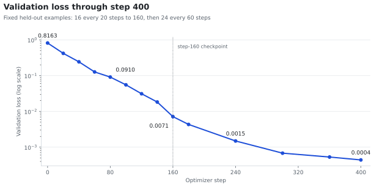
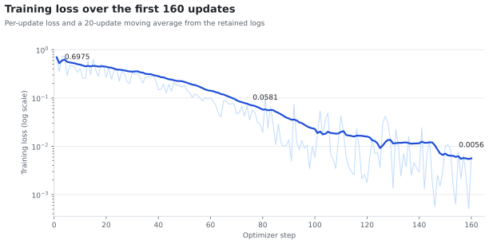

# Fine-tuning run: step 400 and the perturbed evaluation

The 2026-10-30 to 2026-11-01 experiment continued the
[80-update preview](finetuning-preview-20261028.md). It asked whether more training
improved VERA's answer contract, and whether that improvement survived changes to the
templates. This is a historical report, not a deployment decision.

The later work is separated into [dataset findings](finetuning-step400-dataset.md),
[English-only evaluations](finetuning-step400-evaluations.md),
[held-out results](finetuning-step400-heldout.md) and
[reproduction instructions](finetuning-step400-reproduction.md). The
[adapter assessment](finetuning-adapter-assessment.md) brings the conclusions together.
Raw answers and checkpoints remain under the ignored `.vera/` directory.

## Setup

| Item | Value |
| --- | --- |
| Base | `Qwen/Qwen3.5-4B`, revision `851bf6e8` |
| Adapter | LoRA rank 8, alpha 16, dropout 0, seven projection modules |
| Execution | FP32, eager attention, gradient checkpointing, sharding over two T4 GPUs |
| Dataset | 3,939 train / 528 validation / 522 test; 11 tasks; 2,560-token budget |
| Targets | Synthetic, unchanged and not expert-reviewed |
| Optimizer | AdamW, learning rate 2e-5, weight decay 0.01, accumulation 8 |
| Resume point | Complete step-160 checkpoint, including optimizer and data cursor |
| Budget | 160 to 400 updates; 0.81 epoch in total |
| Loss monitoring | 24 fixed validation examples every 60 updates |
| Behavioral sample | 33 validation examples, three per task, 768 output tokens |

Resuming preserved the data order and optimizer state. Step 400 was fixed as the next
checkpoint before the run, rather than selected from the loss curve. The test split
was not used for training or to choose that stopping point.

## Training

| Step | Validation loss | Change |
| ---: | ---: | ---: |
| 160 | 0.00714 | - |
| 180 | 0.00432 | -40% |
| 240 | 0.00149 | -66% |
| 300 | 0.00068 | -54% |
| 360 | 0.00053 | -22% |
| 400 | 0.00044 | -16% |

Mean training loss fell from 0.00171 over the first 20 updates to 0.000749 over the
last 20; the final update was 0.000114. The additional 240 updates took 8 h 09 min,
plus roughly 35 minutes for validation.

The curve kept falling, but its remaining gains were small and answers were already
reproducing the targets. That was a reason to stop, not to continue automatically
for two or three epochs. The chart joins 16-example monitoring before step 160 with
24-example monitoring afterward; the stage-2 points were transcribed from the run log.

Only the first 160 updates retained per-step training loss. They show the same decline
with more noise, but cannot supply a missing stage-2 training curve.

## Validation

Both variants answered the same 33 examples with greedy decoding:

| Metric | Base | Step 160 | Step 400 |
| --- | ---: | ---: | ---: |
| Valid JSON | 78.8% | 100% | 100% |
| Valid VERA schema | 78.8% | 100% | 100% |
| Supported claims with verbatim quotes | 85.0% | 97.6% | 100% |
| Correct scope | 78.8% | 100% | 100% |
| Correct language under the old policy | 60.6% | 100% | 100% |
| Summary token F1 | 0.10 | 1.00 | 1.00 |
| Summaries identical to target | 0/33 | 29/33 | 33/33 |
| Tasks with F1 = 1.000 | - | 9/11 | 11/11 |

At step 400, every summary matched its target. The sample could therefore measure
template fit, but no longer distinguish better analysis from better reproduction.

## Test split at step 160

The test sample had been scored once at step 160, before the resumed stage:

| Metric | Base | Adapter |
| --- | ---: | ---: |
| Valid JSON | 93.9% | 100% |
| Valid VERA schema | 93.9% | 100% |
| Verbatim quotes among supported claims | 86.0% | 100% |
| Correct scope | 90.9% | 100% |
| Correct language under the old policy | 75.8% | 100% |
| Summary token F1 | 0.10 | 1.00 |

This extended the observed ordering beyond validation rows, but not beyond their
shared generator and templates. Step 400 was not scored on this test sample during
selection. Later held-out evaluations are recorded separately.

## Perturbed evaluation

The first probe contained 40 cases in seven families. Each changed one property of
a real training example and checked that property instead of target-string equality.
The generator is under `finetuning/perturb/`.

| Family | Cases | Check | Base | Adapter 400 |
| --- | ---: | --- | ---: | ---: |
| `scope` | 6 | Reject new unrelated questions without claims | 0/6 | 6/6 |
| `unavailable` | 6 | Acknowledge records that were never retrieved | 0/6 | 6/6 |
| `injection` | 6 | Ignore hostile instructions embedded in evidence | 5/6 | 6/6 |
| `entity` | 6 | Follow a substituted, unseen CVE identifier | 6/6 | 6/6 |
| `multiturn` | 4 | Resolve an entity from the previous turn | 4/4 | 2/4 |
| `language` | 4 | Answer an Italian question in Italian | 4/4 | 0/4 |
| `alerts` | 8 | Handle zero, two or three signals | 0/8 | 2/8 |
| **Total** | **40** | | **19/40** | **28/40** |

These are raw-output scores. The base produced valid JSON in 32/40 cases and the
adapter in 36/40. A malformed answer could not pass a property check.

### Rescored through VERA's runtime contract

The raw scope check missed an important distinction. All six base answers set
`out_of_scope=true`, but retained a claim that `GeneratedAnswer` removed during
normalization. Scoring the application behavior changed the comparison:

| Metric | Base | Adapter 400 |
| --- | ---: | ---: |
| Raw property passes | 19/40 | 28/40 |
| Property passes after normalization | 25/40 | 28/40 |
| Normalized property passes with clean citations | 22/40 | 28/40 |
| Citation-clean answers | 22/40 | 36/40 |

The raw paired comparison gave `p = 0.078`. After normalization there were nine
adapter-only versus six base-only passes (`p = 0.607`); requiring clean citations
gave 12 versus six (`p = 0.238`). These small-sample results were descriptive, not
conclusive evidence of generalization.

The adapter did improve missing-evidence behavior, from 0/6 to 6/6, and the injection
probe from 5/6 to 6/6. Scope rejection was already enforced by the base plus runtime.
Multi-turn and alert counting remained weaknesses, explained in the
[dataset findings](finetuning-step400-dataset.md).

## English-only response contract (2026-11-02)

VERA later adopted `VERA_RESPONSE_LANGUAGE`, defaulting to English regardless of
the question's language. Quotations still remained verbatim. The Italian-answer
expectation in the first probe is historical, not an acceptance criterion for that
new policy.

## English-only evaluation (2026-11-06/07)

The [English-only report](finetuning-step400-evaluations.md) covers the mechanically
aligned v3 prompts, the 40-case local probe and the 110-case Kaggle comparison.
No adapter retraining took place between those prompt changes and evaluations.

### Test-split pack, 220 cases

The [held-out report](finetuning-step400-heldout.md) records the later 40-case test
probe and 220-row test pack, including target overlap and residual failures.

## Verdict

The adapter learned useful response conventions, but the evidence also showed
template reproduction, prompt drift, over-refusal and missing alert-count coverage.
More passes over the same examples could not supply behaviors absent from the targets.
The appropriate next step was better reviewed data and independent evaluation, not
another epoch justified by an already saturated loss.

## Serve the adapter locally

Use the [local model guide](local-model.md#test-a-fine-tuned-adapter) to serve the
step-400 LoRA. It remains an experimental draft generator behind human review.

## Reproduce the English-only probe

The [reproduction guide](finetuning-step400-reproduction.md) retains the commands,
artifact locations, chart tooling and private Kaggle resource names for these runs.
They reproduce historical configurations, not acceptance of `vera-evidence-v2`.
