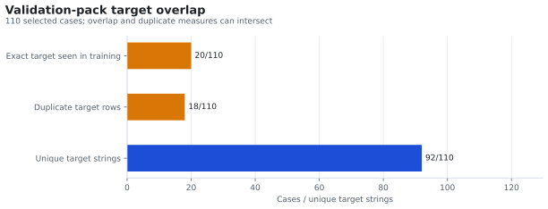
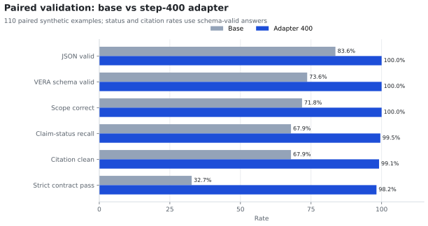
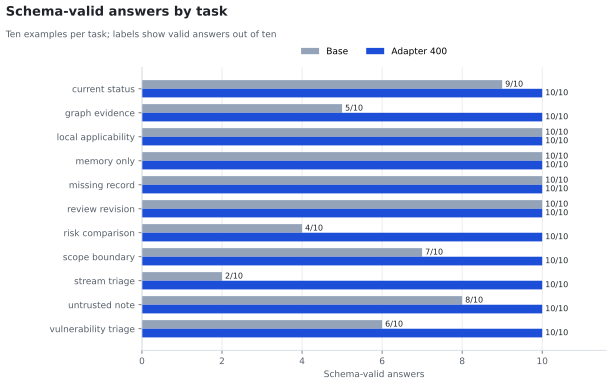
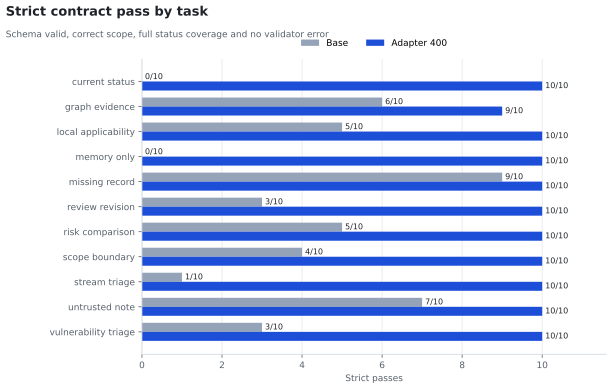
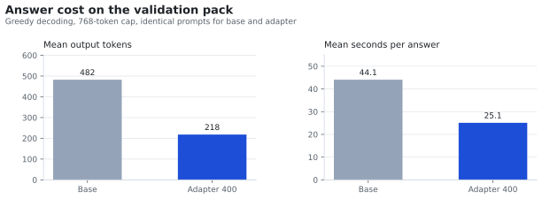

# Step-400 evaluations with aligned prompts

After the [original experiment](finetuning-run-20261101.md), the evaluation prompts
were aligned first to v2 and then to the English-only v3 contract. The adapter was
not retrained. The distinction matters: these runs measure observed behavior under
new prompts, not training on those prompts or acceptance of today's runtime.

## Expanded v2 validation

The 110-row pack used ten examples from each of 11 tasks. A larger 220-row validation
selection was prepared but not run at this stage. Both excluded the first 33
behavioral examples and 24 loss-monitoring rows, while retaining template overlap:
the smaller pack had 20 training-target overlaps and 18 duplicate rows, the larger
40 and 38.

Kaggle completed all 220 paired generations for the 110 cases, with no training:

| Metric | Base | Adapter 400 |
| --- | ---: | ---: |
| Valid JSON | 92/110 (83.6%) | 110/110 (100%) |
| Valid schema | 81/110 (73.6%) | 110/110 (100%) |
| Correct scope | 79/110 (71.8%) | 110/110 (100%) |
| Mean status recall, schema-valid answers | 0.679 | 0.995 |
| Unavailable presence, valid cases where expected | 24.1% | 100% |
| Citation failures, schema-valid answers | 32.1% | 0.9% |
| Memory-citation violations | 10 | 0 |
| Mean output tokens | 494 | 214 |
| Mean seconds per answer | 43.9 | 22.4 |

Requiring valid schema, correct scope, all expected statuses and no validator errors
gave 36/110 passes for the base and 108/110 for the adapter. On the 90 targets absent
from training, the result was 31/90 versus 88/90. The adapter's remaining failures
were a non-verbatim `graph_evidence` quote and a missing `system_inference` status
in `vulnerability_triage`.

The base reached the output limit 18 times; all 18 answers were invalid JSON, with
11 further schema failures. No expert rated answer quality, and the run predated
the English-only setting.

## The English-only change

On 2026-11-02, `VERA_RESPONSE_LANGUAGE` became the central language setting, with
English as its default. Evidence quotations continued to preserve their source
language. The aligned v3 candidate used the 3,660-character runtime prompt
(`010be6a5…`) while preserving every assistant target.

New 110- and 220-case packs excluded prior examples by parent ID and excluded the
24 loss rows. They retained the same 20/40 training-target overlaps and 18/38
duplicate rows. The candidate remained unauthorized for training.

## English-only evaluation (2026-11-06/07)

Two paired runs followed: a local Q6_K comparison with the F16 LoRA on 40 perturbed
cases, and an FP32 Kaggle comparison on 110 validation cases. Both used the aligned
v3 prompts and contract, without retraining.

### Perturbed set, 40 cases

This set came from training-split prompts. Italian questions now expected English
answers, while quotations remained verbatim. The historical scorer applied Pydantic
normalization, whole-answer entity lookup and the runtime citation validator.

| Metric | Base | Adapter 400 |
| --- | ---: | ---: |
| Valid JSON | 33/40 | 35/40 |
| Valid schema | 31/40 | 35/40 |
| Property pass after normalization | 23/40 (57.5%) | 33/40 (82.5%) |
| Property pass with clean citations | 18/40 (45.0%) | 33/40 (82.5%) |
| Paired property comparison | - | 11 versus 1, `p = 0.0063` |
| Paired property and grounding | - | 15 versus 0, `p = 0.000061` |

| Family | Cases | Base | Adapter 400 |
| --- | ---: | ---: | ---: |
| `scope` | 6 | 5/6 | 6/6 |
| `unavailable` | 6 | 0/6 | 6/6 |
| `injection` | 6 | 5/6 | 6/6 |
| `entity` | 6 | 6/6 | 5/6 |
| `multiturn` | 4 | 4/4 | 4/4 |
| `language` | 4 | 3/4 | 4/4 |
| `alerts` | 8 | 0/8 | 2/8 |

The adapter handled scope rejection, missing evidence, injection, multi-turn and
language on this sample, but missed one substituted CVE and six alert cases.
The entity check looked across the answer because all 240 `current_status` training
summaries were constant and omitted CVE names.

Two earlier language failures were measurement artifacts: short English sentences
provided too little stopword signal. Accent folding and an inconclusive result for
undetermined language corrected that, while whole-answer lookup corrected the entity
check. These were scorer changes; the answers were not regenerated.

Scope here meant rejecting unrelated requests. It did not measure accepting valid
cybersecurity questions, which the later [scope probe](finetuning-adapter-assessment.md#scope-probe-refusal-in-both-directions-2026-11-09)
showed was a serious weakness.

### Kaggle validation pack, 110 cases

| Metric | Base | Adapter 400 |
| --- | ---: | ---: |
| Valid JSON | 101/110 (91.8%) | 110/110 (100%) |
| Valid schema | 97/110 (88.2%) | 110/110 (100%) |
| Correct scope | 91/110 (82.7%) | 110/110 (100%) |
| Mean status recall | 0.670 | 1.000 |
| Unavailable presence when expected | 30.0% | 100% |
| Citation failures | 28.9% | 0.9% |
| Memory-citation violations | 10 | 0 |
| Exact quote rate | 90.2% | 100% |
| Mean output tokens | 482 | 218 |
| Mean seconds per answer | 44.1 | 25.1 |

The stricter contract check gave 43/110 versus 109/110, or 39/90 versus 89/90 on
targets absent from training. The adapter passed all ten cases on ten tasks and
nine on `graph_evidence`; its only failure was a non-verbatim quotation. The base
lost most on `current_status`, `memory_only` and `stream_triage`.

A coarse summary-language check detected no non-English answer. The base supplied
101 English summaries and nine invalid answers; the adapter had 90 detected-English
summaries and 20 too short or neutral to classify. That is not full language
identification.

## What near-perfect scores meant

The adapter reproduced 104/110 target summaries exactly, including 84/90 targets
absent from training, with mean token F1 0.991. Claim texts matched in 107/110 cases.
The base reproduced no summary exactly and had F1 0.113.

| Training task | Rows | Unique summaries | Unique claim texts |
| --- | ---: | ---: | ---: |
| `current_status` | 240 | 1 | 241 |
| `memory_only` | 240 | 1 | 1 |
| `risk_comparison` | 239 | 1 | 451 |
| `scope_boundary` | 238 | 1 | 0 |
| `stream_triage` | 108 | 2 | 46 |
| `missing_record` | 240 | 240 | 1 |
| `vulnerability_triage` | 1,332 | 1,332 | 1,366 |

This is strong evidence of contract fit on a low-entropy target distribution, not
proof of factual analysis or usefulness. Valid schema means the answer satisfies a
data model; even the stricter score cannot establish semantic correctness. The
[held-out results](finetuning-step400-heldout.md) broadened the comparison, but
retained the same template limitation.
