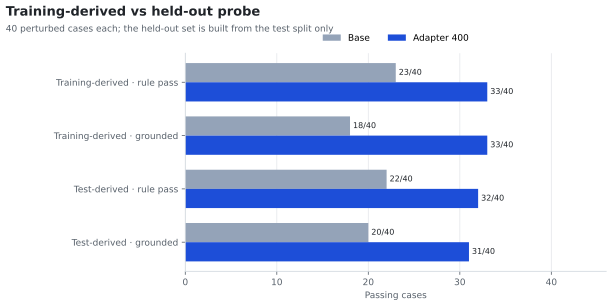
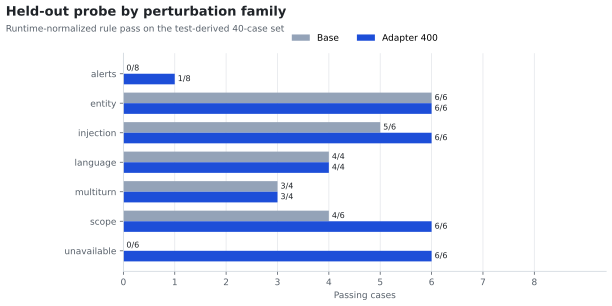

# Step-400 results on held-out rows

The first English-only probe came from training-split examples. The next comparison
used rows from the held-out test split to see whether the same behavior persisted.
These are historical results from the step-400 adapter, not approval of the current
runtime or independently authored targets.

## Held-out test probe (2026-11-07)

`finetuning/perturb/build.py` generated 40 cases with seed 20261107: eight alert cases,
six each for entity, scope, injection and unavailable evidence, and four each for
language and multi-turn. No IDs overlapped training. However, 56 of the 522 test
rows still shared an exact target with training.

| Set | Rule pass | Grounded pass |
| --- | ---: | ---: |
| Training-derived, base | 23/40 | 18/40 |
| Training-derived, adapter | 33/40 | 33/40 |
| Test-derived, base | 22/40 | 20/40 |
| Test-derived, adapter | 32/40 | 31/40 |

On the test-derived set, the rule comparison had 11 adapter-only against one
base-only pass (`p = 0.0063`). Requiring grounding gave 13 against two (`p = 0.0074`).
For comparison, the training-derived values were `p = 0.0063` and `p = 0.000061`.
The change between sets was only one or two cases; this probe did not show a collapse
when moving to held-out rows.

| Family | Base | Adapter |
| --- | ---: | ---: |
| `alerts` | 0/8 | 1/8 |
| `entity` | 6/6 | 6/6 |
| `injection` | 5/6 | 6/6 |
| `language` | 4/4 | 4/4 |
| `multiturn` | 3/4 | 3/4 |
| `scope` | 4/6 | 6/6 |
| `unavailable` | 0/6 | 6/6 |

Missing-evidence handling, injection resistance and rejection of unrelated questions
transferred on this sample. That last result was one-sided: the
[scope probe](finetuning-adapter-assessment.md#scope-probe-refusal-in-both-directions-2026-11-09)
later found substantial in-domain over-refusal.

Counting remained the clearest gap. The training targets contained only zero or one
signal, and the adapter managed just 1/8 alert cases here. Entity, language and
multi-turn scores were already close to the ceiling for both models.

Some local `llama-server` generations stalled for roughly 35 minutes. With greedy
decoding, the stalls delayed the run but were not a scoring input.

## Test-split pack, 220 cases

A larger selection used 20 examples from each task, seed 20261107, with no IDs shared
with the validation pack. Base and adapter ran locally on the Q6_K GGUF with the
step-400 LoRA. The local run was recorded on 2026-11-08.

| Metric | Base | Adapter 400 |
| --- | ---: | ---: |
| Valid JSON | 202/220 (91.8%) | 220/220 (100%) |
| Valid schema | 192/220 (87.3%) | 220/220 (100%) |
| Correct scope | 85.0% | 100% |
| Mean status recall | 0.701 | 1.000 |
| Unavailable presence when expected | 33.9% | 100% |
| Citation failures | 28.6% | 0.5% |
| Memory-citation violations | 26 | 0 |
| Exact quote rate | 91.1% | 100% |
| Strict contract passes | 86/220 (39.1%) | 219/220 (99.5%) |

The adapter reached 20/20 strict passes on ten tasks and 19/20 on
`vulnerability_triage`, where one quote was not verbatim. The base scored 0/20 on
`current_status` and `memory_only`, 2/20 on `review_revision`, 3/20 on
`stream_triage` and 4/20 on `vulnerability_triage`.

Forty selected targets were also present in training: 20 each from `memory_only`
and `scope_boundary`. Thirty-eight selected rows duplicated another target.
The adapter repeated the target summary in 209/220 cases, including 169/180 targets
absent from training, with mean token F1 0.978. Claim text matched in 210/220 cases.
The base had no exact summary matches and F1 0.110.

The larger pack confirmed the same ordering and the same limitation: the adapter
fit this target distribution extremely well. It did not turn shared templates into
independent evidence of incident-analysis quality, and it did not authorize deployment.
The [reproduction guide](finetuning-step400-reproduction.md) retains the commands
and artifact locations.
