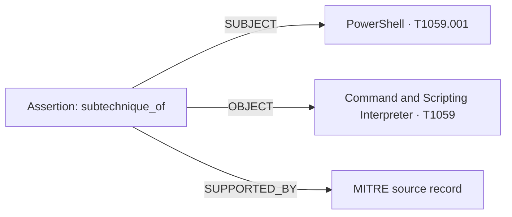

# Kuzu knowledge graph

VERA uses Kuzu 0.11.3 as an optional embedded domain graph. LangGraph executes the
workflow; SQLite retains history and graph projection jobs. No Kuzu server is required.
The graph is disabled by default and is built explicitly from the local corpus.

## Install and build

```bash
uv sync --extra dev --extra knowledge-graph
uv run --extra knowledge-graph vera kg-build
uv run --extra knowledge-graph vera kg-status
export VERA_KG_ENABLED=true
```

Alternatively set `VERA_KG_ENABLED=true` in `.env`. The default database is
`.vera/knowledge.kuzu`; change it through `VERA_KG_PATH`. `kg-build` imports incrementally
without deleting the database. Repeating it does not duplicate unchanged source records.
After an explicit `vera corpus-sync`, run `kg-build` again to import the synchronized data.

The bundled corpus includes a bounded official subset: ATT&CK 17.1 tactics, techniques,
four mitigations, APT29 and Cobalt Strike; CWE 4.20 primary hierarchy mappings; CAPEC 3.9
related weaknesses; three CVEs from CISA KEV catalog 2026.10.08; and eight OWASP 2021 CWE
mappings. It provides 120 entities and 112 supported assertions before run projection.
Generic NIST/OWASP documents describe guidance entities and explicitly classified topics;
CAG documents describe named security concepts. Topic classifications are curated in
record metadata, not inferred from text similarity. Source snippets retain version/URL
metadata; these are focused snapshots, not complete or continuously refreshed catalogs.
ATT&CK synchronization additionally preserves `uses`, `mitigates`, subtechnique, and tactic
mappings. NVD, CVE.org, and CISA records provide `has_weakness`
when their structured fields contain CWE IDs. Live lookup evidence is projected after
analysis and becomes available to subsequent requests. No asset inventory, affected-version
matching, or automatic CVE-to-technique mapping is implemented.

## Inspect the graph

```bash
uv run --extra knowledge-graph vera serve
```

Open **http://127.0.0.1:8000/knowledge-graph**. Search from the header by name, alias,
or ID: `PowerShell`, `Log4Shell`, `SQL injection`, `incident response`, or `T1059.001`.
Use the arrow keys and Enter, or click a suggestion, to disambiguate names.
Use the node list or graph to inspect sources; **Explore neighbors** continues navigation.
Select a connection to inspect its predicate, status, and sources. Pan, zoom, and Fit work
on mobile too. Overview displays a bounded subset.

The default view draws direct semantic connections and combines repeated support for the
same relationship. The toolbar sets the relationship limit, opens **Overview**, and toggles
**Sources & assertions** to display Assertion/SourceRecord provenance nodes.
This is a custom local SVG frontend backed by the Kuzu API, not Kuzu Explorer.
The [Workflow Explorer](workflow-explorer.md) at `/graph` runs questions and displays execution.
Viewing a built database does not enable graph retrieval by itself.

Read-only HTTP endpoints:

- `/v1/knowledge-graph/status`: availability, schema version, node counts.
- `/v1/knowledge-graph?id=T1059.001&limit=50`: bounded entity neighborhood.
- `/v1/knowledge-graph?id=PowerShell&provenance=true`: provenance view.
- `/v1/knowledge-graph/search?q=Power`: bounded name/alias/ID suggestions.

Export the same view, not a complete database backup:

```bash
uv run --extra knowledge-graph vera kg-export --id T1059.001 --output /tmp/knowledge-graph.json
```

For full Cypher inspection, stop VERA and open `.vera/knowledge.kuzu` in a compatible
Kuzu Explorer installation. The Explorer query `MATCH p = ()-->() RETURN p LIMIT 100`
displays source links, assertions, and projected run/alert/event links. Do not open the
same database concurrently in a separate writer process.
In the installed VS Code Kuzu Explorer 0.2.1, press **Ctrl+Shift+P** and choose
**Kuzu: Run Cypher Query**. The **Kuzu Query** tab has a text box and a
**Run (Ctrl/Cmd+Enter)** button; query results are tables.
**Kuzu: Show Graph** opens a separate graph view, not the graph of a query result.
For a readable Table result, use:

```cypher
MATCH (a:Assertion)-[:SUBJECT]->(s:Entity), (a)-[:OBJECT]->(t:Entity)
RETURN s.name, a.predicate, t.name;
```

## Verify that requests use Kuzu

```bash
VERA_KG_ENABLED=true uv run --extra knowledge-graph vera analyze \
  "Explain MITRE ATT&CK T1059.001" --offline --json > /tmp/vera-kg.json
python3 -c 'import json; r=json.load(open("/tmp/vera-kg.json")); print(json.dumps(r["metadata"]["knowledge_graph"], indent=2))'
```

Inspect `metadata.knowledge_graph`:

| Field | Meaning |
| --- | --- |
| `enabled` | Graph retrieval was configured |
| `attempted` | The acquisition branch actually queried Kuzu |
| `available` | The query completed against a valid graph |
| `seed_ids`, `entity_ids` | Starting IDs and reached entities |
| `assertion_ids` | Traversed domain relationships |
| `evidence_ids` | Source records retrieved from Kuzu |
| `retained_evidence_ids` | Graph evidence retained after workflow deduplication |
| `cited_evidence_ids` | Graph evidence cited in the final response |
| `projection` | Run projection is `complete` or awaiting retry as `pending` |

For the bundled `T1059.001` request, expect `attempted=true`, `available=true`, a link to
`attack:enterprise:T1059`, and nonempty retained/cited IDs. Repeat with `Explain PowerShell`
or `Analyze Log4Shell`: name/alias resolution supplies the starting entity. The trace includes
`knowledge_graph:...`. A nonempty `cited_evidence_ids` demonstrates use in the answer,
not just database availability. Citation IDs have an `ev-kg-` prefix; metadata preserves
the original evidence ID and immutable graph record key.

Repeat with `VERA_KG_ENABLED=false`: `enabled` becomes false and no graph IDs are returned.
Try `Explain MITRE ATT&CK T9999`: the graph is queried but has no matching evidence.
Queries with no recognized identifier, complete name, or alias do not traverse relationships.
Name resolution is deterministic and does not use an LLM. Acquisition runs
in the RAG/tools/full branches, including when ReAct is enabled; it is not a model-selected
ReAct action. Conceptual CAG-only and benign stream-only branches do not query the graph.

```bash
uv run --extra dev --extra knowledge-graph pytest
uv run --extra dev --extra knowledge-graph ruff check .
```

The graph tests cover repeated import, two-hop retrieval, source conflicts, failed-import
rollback, missing databases, simulation, CLI/API inspection, and projection retries.
A workflow test disables lexical retrieval and verifies that graph-only evidence is cited.

## Data and operational contract

The schema lives in `src/vera/knowledge_graph/schema.py` (version 2). Explorer shows both
domain knowledge and the technical structure that records its sources and analysis history.

| Node | Meaning |
| --- | --- |
| `Entity` | A CVE, CWE, CAPEC, technique, tactic, mitigation, group, software, guidance, or concept |
| `Assertion` | A sourced statement: subject + predicate + object; not an automatically verified fact |
| `SourceRecord` | An immutable evidence version with title, content, URL, status, and metadata |
| `Run` | One completed analysis, identified by its run ID |
| `Alert` | A detector alert scoped to a run, with its rule and original payload |
| `Event` | A run-scoped input event retained because it contributed to an alert |
| `GraphMeta` | Internal schema version; its isolated node is expected |

| Technical edge and direction | How to read it |
| --- | --- |
| `Assertion —SUBJECT→ Entity` | This entity is the subject of the statement |
| `Assertion —OBJECT→ Entity` | This entity is the object of the statement |
| `Assertion —SUPPORTED_BY→ SourceRecord` | This source supports the statement; the edge stores its quote/field path |
| `SourceRecord —DESCRIBES→ Entity` | This document describes the entity; it does not establish a relation between entities |
| `Run —USED_RECORD→ SourceRecord` | This evidence appears in the saved result, not necessarily in its final citations |
| `Run —HAS_ALERT→ Alert` | This analysis produced the alert |
| `Run —HAS_EVENT→ Event` | This analysis retained the event supporting an alert |
| `Alert —TRIGGERED_BY→ Event` | This event contributed to triggering the alert |
| `Alert —SUGGESTS→ Entity` | A detector suggests an association with a technique/CVE; not proof of compromise |

The semantic relation is `Assertion.predicate`, not `SUBJECT` or `OBJECT`. For example:



Read this as **PowerShell is a subtechnique of Command and Scripting Interpreter,
supported by the MITRE source**. The semantic viewer renders that as one direct connection.
Other predicates: `has_weakness` (CVE→CWE), `part_of` (technique→tactic),
`mitigates` (mitigation→technique), `uses` (group/software→technique/software),
`child_of` (specific→parent CWE), `exploits_weakness` (CAPEC→CWE),
`covers` (guidance→concept), and `includes_weakness` (guidance→CWE).
Technical hashes identify source versions/assertions; use names/titles for display.
Separate document→entity pairs can be valid when no structured relation is available.

Names and aliases can be refreshed; a reference containing only an ID cannot erase a known
name. Source titles are first-class properties for external viewers. `kg-build` upgrades a
version 1 database in place, retaining sources, assertions, and runs. Existing identical
document versions share descriptive links without changing their original evidence payload.

Structured mappings remain `system_inference`; they do not bypass quotation validation.
Original available non-memory source text can support a factual claim. Simulated alerts
stay simulated, graph paths do not prove compromise, and a missing edge is not a negative
fact. Source identity includes content, URL, availability and version/date metadata;
retrieval time alone does not create duplicate records. The first retrieval time is
retained. Conflicting source versions coexist, and cached API records are not current
live lookups. No automatic expiry policy is implemented.

`VERA_KG_HOPS` permits one or two logical hops (default one). `VERA_KG_MAX_RESULTS`
limits returned records and each traversal frontier (default 12); identifiers are capped
at eight. Each query has `VERA_KG_QUERY_TIMEOUT_MS` (default 3000). Inputs are bound to
fixed Cypher templates; models cannot execute arbitrary queries or write graph facts.

If the enabled graph is missing, incompatible, locked, or fails, analysis continues with
ordinary retrieval and explicit warnings. SQLite commits a projection job with the run;
failed projection retries on later enabled analyses or `kg-build`. Only runs analyzed
with graph support enabled create these jobs. Connections close after each operation;
initially use one API worker. Unknown schema versions are rejected. Do not replace/delete
a database while it is open; stop other processes before upgrading it.

Kuzu's [official repository](https://github.com/kuzudb/kuzu) is archived. The dependency
is pinned to 0.11.3 and the integration requires no extensions. See the
[Python API](https://kuzudb.github.io/docs/client-apis/python/) for external inspection.
