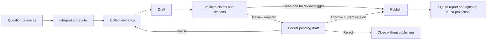

# VERA: architecture, evidence, and evaluation

VERA is a cybersecurity analysis system that drafts evidence-linked reports from
questions and normalized events. Its main design choice is to separate what an
external model proposes from what the system can verify and publish. The
[presentation](../VERA-presentation.pdf) summarizes the experiments and their limits.

## Problem and scope

A report should distinguish a published description from an observation about a
specific environment. A CVE record describes a vulnerability, CVSS describes
severity, EPSS estimates exploitation probability, and KEV records known
exploitation. None of these alone establishes local exposure or compromise. VERA
does not implement asset inventory or affected-version matching.

An analyst can ask a question through the chat, API or CLI. Structured events go
through deterministic detectors before generation; text describing traffic is
not detector input. The CLI can normalize PCAP with `tshark`. Replays stay marked
as simulated and do not establish an actor, an incident or actual downtime.

## System architecture



[LangGraph](../src/vera/workflow/graph.py) coordinates the workflow. The model
interprets the user's intent and drafts a response, but explicit identifiers and
event input retain their evidence path. The resource plan combines curated
context, corpus retrieval, bounded tools and stream processing. Optional
[ReAct](../src/vera/workflow/react.py) can select among permitted actions and
records the action, operational reason, outcome and evidence IDs. It is not an
unrestricted command runner, and the trace is not a record of the model's private
reasoning.

The local corpus combines BM25 with embeddings and considers provenance and
freshness when selecting records. VERA can also consult read-only external
sources if enabled. A dated snapshot, cached record and live lookup are distinct
evidence paths. Conversation history and memory help resolve references but
cannot establish a fact.

[Kuzu](knowledge-graph.md) is separate from the workflow engine. An `Assertion`
links two `Entity` nodes and points to the `SourceRecord` that backs it. A bounded
traversal expands from entities resolved from the query. VERA combines the
graph records with its other evidence and leaves the document search query
unchanged. Establishing local execution requires observations from the environment.

## Validation and human review

The [validation contract](architecture.md#evidence-and-limits) distinguishes
`supported_fact`, `system_inference`, `simulated` and `unavailable`. Every
supported fact must quote a relevant, available, non-memory record verbatim.
Checking a quotation is not enough to validate all the prose around it. VERA
holds non-extractive summaries (and other review triggers) outside published
history, memory and graph projection. It retains citation failures after repair
and requires abstention for exact identifiers when there are neither matching
records nor event evidence.

SQLite stores the workflow checkpoint, report history and review decisions.
Approval requires the current draft version and compatible validation provenance.
Revision gathers evidence again and pauses for another decision. Rejection closes
the draft without publishing. Retrying an already applied decision with the
same UUID and payload does not apply it again. See the
[review API](chat.md#human-review) for the exact states and HTTP responses.

## Paired retrieval probe

We ran the same 12 definition queries with the graph off and on: six requests
using exact identifiers and six using names. The probes cover subjects already
documented in the bundled records. Both configurations used the deterministic provider,
hash embeddings, only bundled knowledge and corpus snapshots, and no live
sources, web search, memory recall or ReAct. The graph allowed one hop and up to
12 results. Each run had fresh SQLite storage and, with the graph enabled, a
fresh copy of the built Kuzu snapshot. That snapshot contained 122 entities,
130 source records and 112 assertions before any reports were projected.

| Query-level measure | Graph off | Graph on |
| --- | ---: | ---: |
| Expected record at rank 1 | 11/12 | 12/12 |
| Expected record among the first 5 | 12/12 | 12/12 |
| Expected record cited in a supported fact, with no validation failures | 12/12 | 12/12 |
| Expected citation backed by a graph record | 0/12 | 12/12 |

We measured the rank among available knowledge records retained in the report.
A hit requires the expected identifier in a primary record title. We excluded
relationship titles. The graph returned `T1021` for **Define Remote Services.**, moving its direct record from
second to first ahead of `T1210`. Both runs cited `T1021`, so citation coverage
stayed the same. Harder queries and the quality of externally generated prose
remain open questions.

To reproduce from the repository root:

```bash
uv run --extra knowledge-graph python presentation/scripts/measure-graph.py
```

The command emits per-query JSON and uses temporary local stores. To inspect
the integration, compare `graph_seed_ids`, `evidence_titles`, `cited_titles` and
the validated graph citation flag. Do not infer graph use from configuration
alone: availability, retention and citation are separate outcomes.

## Observed review trace

The same probe runs a separate synthetic case using the bundled
`syn-flood.jsonl` replay. Its 20 normalized events triggered one `TCP-SYN-BURST`
alert, and VERA chose the `FULL` route. The high-severity rule held the draft
for review. The probe rejected it deliberately rather than publishing a
synthetic report. The report was absent from history both before and after
rejection, and the graph's `Run` node count stayed at zero.

This trace shows that rejecting a held draft leaves published history and the
graph unchanged. We recorded the order of the steps and left them untimed.
An isolated local-model check separately exercised
actual inference, restart recovery, revision, stale-version rejection,
approval of a synthetic draft and idempotent decision replay.

## Model adaptation and selection

The adapted component is the draft generator. Its input is the question plus
retrieved evidence and any event context. Its output is a structured summary
and claims with citations. The relevant baseline is the same base model
without LoRA. The deterministic provider serves as a non-generative control
in a separate experiment.

The [step-400 run](finetuning-run-20261101.md) used rank-8 LoRA with alpha 16.
On the same 33 validation prompts, exact summary matches went from **0/33**
with the base model to **29/33** at step 160 and **33/33** at step 400. Both
checkpoints had valid schema on all 33. Step 400 was set before resuming, and
the test split did not select it. Exact matching tracks how closely the model
reproduces a target summary. Evaluating analysis quality requires other evidence.

The [v4 dataset](domain-dataset-v4.md) expanded coverage to 18 tasks and used
5,406 training, 686 validation and 720 test rows from public evidence and
controlled replays. It introduced scenarios with up to three signals instead
of only zero or one. V4 ran one epoch over 676 updates. The adapter was
merged into Qwen 3.5 4B and exported to Q6_K. The
[training guide](kaggle-finetuning.md) documents the settings. The checkpoint
comparison varies training length while holding learning rate and rank fixed.

## Results and failures

The [historical v4 paired test](finetuning-v4-results.md#paired-validation-and-test-samples)
found valid schema on 45/54 base answers and 54/54 adapter answers. The adapter
needed 183 output tokens and 19.1 seconds per answer on average, compared with
386 tokens and 34.7 seconds for the base. That pack had 12 training-target overlaps
and five duplicate rows. The separate local probe ran the same eight requests
per Q6_K artifact on 16 GB Apple silicon, with live sources, graph and memory
disabled. Both used JSON-schema mode, a 1,024 output-token cap and a
llama-server context of 8,192 tokens. Median end-to-end latency was **42.8 s**
for the base and **11.7 s** for the merged artifact. Each held six drafts
for review and used no fallbacks. On the missing-identifier rerun after the
changes, the base went from **61.5 s** and three validation errors to
**15.0 s** and zero validation errors. The draft still went to review.

| Observation | Design response | What remains |
| --- | --- | --- |
| [Step 400 passed only 1/8 alert-counting cases](finetuning-step400-heldout.md). | V4 added reports with multiple signals. The runtime keeps actual detector counts separate from model prose. | No matched v4 rerun establishes recovery on those eight cases. |
| [Step 400 refused 19/30 in-domain requests](finetuning-adapter-assessment.md#scope-probe-refusal-in-both-directions-2026-11-09). In 16 cases it refused despite an available, retrievable record. | The runtime now assesses intent structurally and preserves evidence routing when an identifier or definition is supported. | The targeted local rerun passed the selected definition and scope cases. The full 30-case probe still needs repeating. |
| [V4 cited off-topic records in 2/54 paired test answers](finetuning-v4-results.md#what-still-failed), despite matching the schema. | Validate each citation individually and abstain when an exact subject has no matching evidence. | The targeted missing-identifier run eliminated three validation errors in the base model, but some event and multi-source drafts still had citation errors. |

The separate step-400 retrieval audit found the expected record on 22/30
queries with hash hybrid ranking, 23/30 with lexical ranking and 24/30 with
Sentence Transformers. The ten-case follow-up did not eliminate the refusals
by changing the embedding backend. This distinguishes a retrieval miss from
a failure to use evidence the system could already retrieve.

## What the evidence does and does not support

The deterministic probe shows that Kuzu enters the evidence path and can
change ranking. Historical LoRA evaluation shows better adherence to the
measured output contract. Neither result establishes autonomous incident
analysis. An end-to-end evaluation would also need independently reviewed
cases, the exact served artifact and validation contract, semantic assessment
of the responses, and separate coverage for recovery and live integrations.

The [evaluation guide](finetuning-evaluation.md#prepare-an-independent-local-model-study)
defines the acceptance procedure. The 54 draft cases were not run for these
comparisons. Basic model readiness, technical review and a synthetic approval
are not substitutes for human sign-off on an independent pack.

## Reproduction order

Start with the [offline evaluation](../README.md#development) for routing, detectors
and grounding. Next, run the paired graph probe above for retrieval and review
persistence. Use the [local model guide](local-model.md#verify-and-stop) for a
separate smoke check against the exact served artifact. None of these steps
records human acceptance. The [presentation guide](../presentation/README.md)
maps the figures to their sources and explains how to export the PDF.
